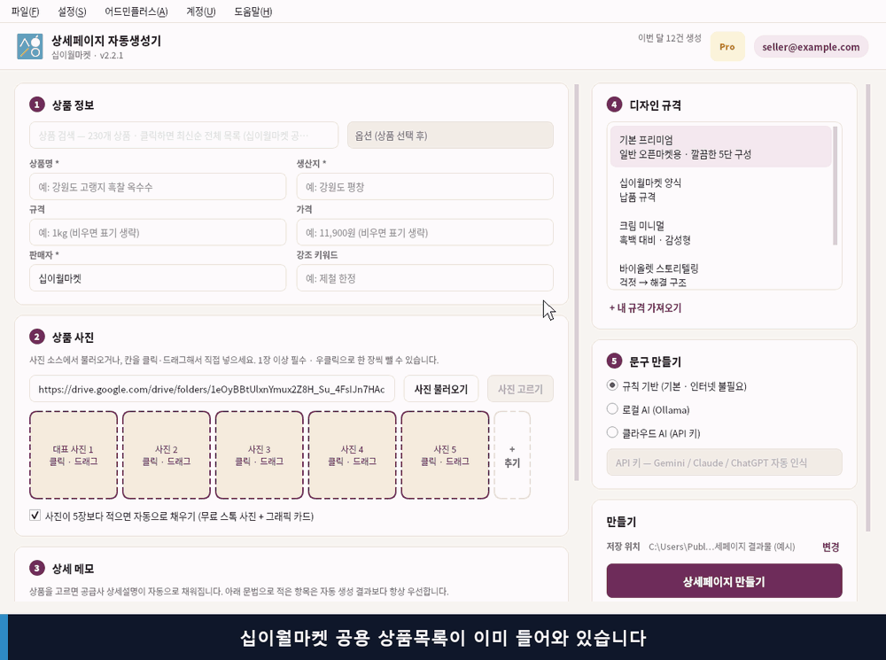
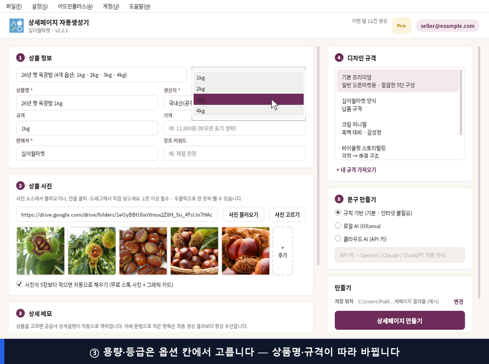
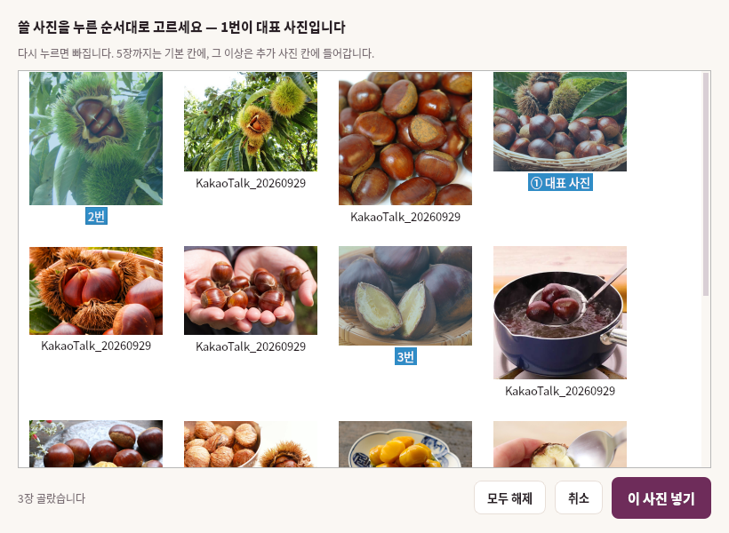
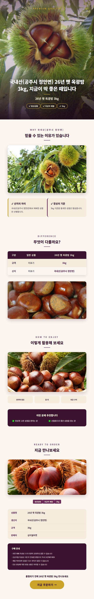
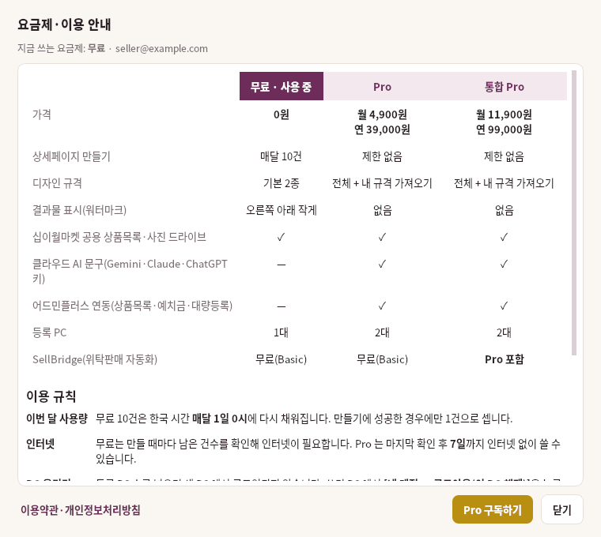

# 상세페이지 자동생성기

십이월마켓 상품을 고르면 **사진·상품 정보가 자동으로 채워지고, 버튼 한 번으로 쇼핑몰용 상세페이지 이미지 5장**이 만들어지는 Windows 프로그램입니다.

**[⬇ 최신 버전 다운로드](https://github.com/jaeil-park/detail-page-generator-releases/releases/latest)** — `DetailPageGenerator-Setup-버전.exe` 를 받아 실행하세요.

실제 프로그램을 그대로 조작한 화면입니다(약 30초). ① 상품 검색 → ② 정보·사진 자동 → ③ 옵션 → ④ 만들기 → 결과 미리보기

---

## 이렇게 동작합니다

| 단계 | 하는 일 | 프로그램이 알아서 하는 일 |
|---|---|---|
| ① 상품 고르기 | 상품 칸을 누르고 고르기(이름 일부로 검색 가능) | 십이월마켓 상품목록(매일 갱신)에서 상품명·생산지·규격·설명을 채움 |
| ② 사진 | 그대로 두거나 [사진 고르기]로 바꾸기 | 십이월마켓 사진 드라이브에서 그 상품 사진 5장을 가져옴 |
| ③ 옵션 | 용량·등급 고르기 | 1kg·2kg·3kg처럼 따로 있던 상품을 한 상품의 옵션으로 묶어 보여 줌 |
| ④ 만들기 | [상세페이지 만들기] | 문구 작성 → 860px 상세페이지 PNG 5장 저장 → 미리보기 |

가격 칸은 비어 있으니 **판매가만 직접 입력**하세요. 판매자 이름은 한 번 저장해 두면 계속 들어갑니다.

<table>
<tr>
<td width="50%" valign="top">

**용량·등급은 옵션으로**

</td>
<td width="50%" valign="top">

**폴더에 사진이 더 있으면, 누른 순서대로**

</td>
</tr>
</table>

## 결과물 예시

공용 목록에서 "26년 햇 옥광밤" 3kg 을 고르고 바로 만든 결과입니다(기본 프리미엄 규격, 손으로 고친 곳 없음). 실제로는 5장으로 나뉘어 저장됩니다.

- **규격 4종** — 기본 프리미엄 · 십이월마켓 양식(무료) / 크림 미니멀 · 바이올렛 스토리텔링(Pro) + 회사 양식 가져오기(Pro)
- **문구** — 기본은 인터넷·설정 없이 동작하는 규칙 기반. 로컬 AI(Ollama)나 API 키(Gemini·Claude·ChatGPT)를 쓰면 더 자연스러운 문구
- 공급처의 발주 안내(마감시간·합배송·택배비 등)는 결과물에 넣지 않고, 메모에 `주의:` 로 적은 내용은 항상 그대로 들어갑니다

## 설치

1. [최신 버전](https://github.com/jaeil-park/detail-page-generator-releases/releases/latest)에서 **DetailPageGenerator-Setup-버전.exe** 를 받아 실행합니다. 관리자 권한 없이 설치됩니다.
2. 파란 창 **"Windows의 PC 보호"** 가 뜨면 **[추가 정보] → [실행]** 을 누르세요(새 프로그램이라 뜨는 안내입니다).
3. 처음 켜면 회원가입 창이 뜹니다. **SellBridge 계정이 있으면 그대로 로그인**하면 됩니다.

**업데이트는 자동입니다.** 새 버전을 뒤에서 받아 두었다가 프로그램을 닫을 때 조용히 설치합니다. 받은 파일은 십이월마켓 서명을 확인한 뒤에만 설치됩니다.

시스템 요구사항: Windows 10 / 11 (64bit)

## 요금제

| | 무료 | Pro | 통합 Pro |
|---|---|---|---|
| 가격 | 0원 | 월 4,900원 · 연 39,000원 | 월 11,900원 · 연 99,000원 |
| 상세페이지 만들기 | 매달 10건 | 제한 없음 | 제한 없음 |
| 디자인 규격 | 기본 2종 | 전체 + 내 규격 가져오기 | 전체 + 내 규격 가져오기 |
| 결과물 표시(워터마크) | 오른쪽 아래 작게 | 없음 | 없음 |
| 공용 상품목록 · 사진 드라이브 | ✓ | ✓ | ✓ |
| 클라우드 AI 문구 · 어드민플러스 연동 | — | ✓ | ✓ |
| 등록 PC | 1대 | 2대 | 2대 |
| SellBridge | 무료(Basic) | 무료(Basic) | **Pro 포함** |

- 무료 10건은 **매달 1일 0시**(한국 시간)에 다시 채워지고, 만들기에 성공한 경우만 셉니다.
- 결제는 계좌이체이며 **자동으로 결제되지 않습니다.** 끝나기 전에 연장 안내 메일을 보내 드립니다.
- 상품 정보·사진·만든 상세페이지는 **서버로 보내지 않습니다.**
- 프로그램 맨 위 **요금제 배지**를 누르면 최신 요금과 이용 규칙을 볼 수 있습니다.

## 사용설명서

릴리즈에 함께 올라간 **manual.html**(사용설명서)을 받아 더블클릭하면 브라우저로 열립니다. 단계별 화면, 옵션·사진 고르기, 메모 문법, AI 설정, 자주 묻는 질문이 들어 있습니다.

## 문의

사용 중 문제가 있으면 담당자에게 문의해 주세요.

---
© 2026 십이월마켓 (12MONTH MARKET). All rights reserved.
